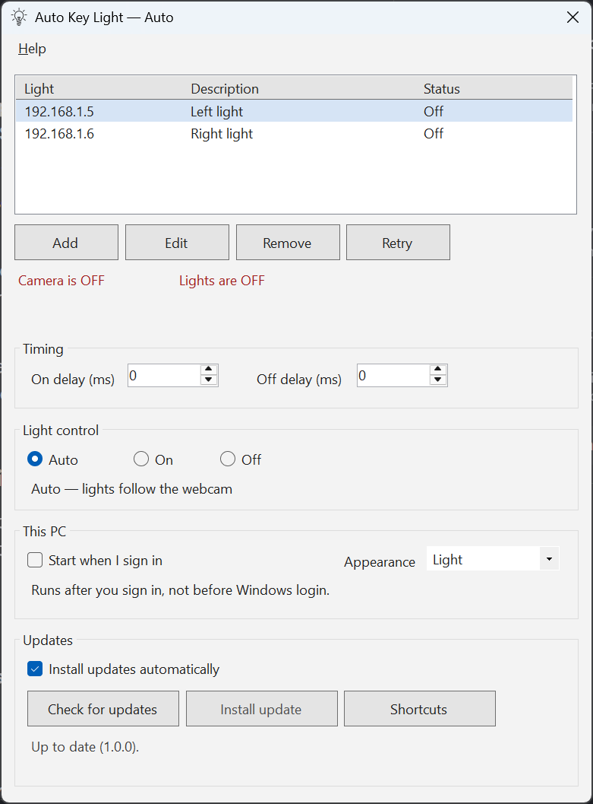

# AutoKeyLight

Automatically turns on and off your Elgato lights when you turn on and off your webcam.



The app will try finding your lights IPs from an existing Elgato Control Center installation. If that fails, please add them manually.

If you have a "phantom" IP where after removing the IP, it comes back after restarting the app, it's most likely due to the Elgato control center app being installed with the IP in its settings. To fix that, open %APPDATA%\Elgato\ControlCenter\Settings.xml and remove any \<Acessory\> tags inside \<Accessories\>, or just delete the file altogether.

To find your keylight IP:


If you know your way around your router, you could get the lights fixed IPs to guarantee reliability.

This fork adds appearance, light control, shortcuts, per-light status, and updates from **Techboy/AutoKeyLight** stable releases. It does not change Windows networking, VPN, routes, or company security software.

AutoKeyLight is MIT licensed. Copyright (c) 2022 Gabriel Garcia. See [LICENSE](LICENSE).

## Light control

**Auto / On / Off** is in the window and on the tray icon menu. The choice is saved for this Windows user.

- **Auto** is the original behavior and the default. Lights follow the webcam. The on delay and the off delay apply. An existing install stays on Auto.
- **On** turns every configured light on and keeps it on, even when the webcam turns off. The app restores On the next time it starts.
- **Off** turns every configured light off immediately and keeps it off, even when the webcam turns on. The app restores Off the next time it starts.
- Choosing **Auto** again sets the lights from the webcam's current state immediately. Delays apply only to webcam changes after that.
- The webcam monitor keeps running so the window can show the real camera state. While the mode is On or Off, that monitor does not change the lights.
- The tray icon still shows whether the camera is on. The window title, the status line, and the check mark on the tray menu show Auto, On, or Off.

## Off delay

The **Off delay (ms)** box is the pause after the camera turns off before automatic mode turns the lights off. It is there so switching camera apps does not flicker the lights.

- New installs use **1500 ms**.
- If you already saved a value, including 0, that saved value is kept.
- Set it to 0 for an immediate automatic off. The maximum is 60 seconds.
- If the camera comes back before the delay ends, the pending off is cancelled and the lights stay as they were.
- **Manual Off does not wait.** It turns the lights off as soon as you choose it.

## Keyboard shortcuts

Shortcuts are optional and **none are set by default**, so the app does not take keys another program already uses.

Open **Shortcuts** from the window or the tray menu. Choose Set, then press Ctrl, Alt, or Shift together with a letter, number, or function key. Esc cancels. Clear removes one. A common choice that rarely clashes is Ctrl+Alt+Shift with a letter.

The shortcut works while the window is closed. The tray menu shows it next to Auto, On, or Off. Common editing and Windows shortcuts, such as Ctrl+C and Alt+F4, are refused. If Windows says another program already owns the shortcut, the app tells you and leaves the previous shortcut in place. Shortcuts are released when you exit from the tray menu.

## Light status

Each light has its own status: **On**, **Off**, **Unreachable**, **Unexpected reply**, or **Checking…**. The summary line does not say the lights are on after a call fails. The **Description** column is saved with the address, for example "Light on the left". Use **Add** or **Edit**, double-click a row, or press Enter or F2. Delete removes the selected light.

**Retry** checks every light again. A light that does not answer within 5 seconds is shown as unreachable. That is only a connection check. It does not change VPN settings, routes, or security software.

## Appearance

**Light**, **Dark**, or **Follow Windows**. The choice is saved. Follow Windows tracks the app theme. High contrast keeps Windows system colors.

## Install

The build is not code-signed. There is no paid certificate. Windows SmartScreen may say "Windows protected your PC" the first time you open the installer or the program. Choose **More info**, then **Run anyway**.

### Per-user installer

1. Open the latest stable release: https://github.com/Techboy/AutoKeyLight/releases/latest
2. Download `AutoKeyLight-Setup.exe`. `AutoKeyLight-Setup.exe.sha256` is the checksum for that file.
3. Run the setup. It does not ask for administrator approval. It installs to `%LOCALAPPDATA%\Programs\AutoKeyLight`, adds an **Auto Key Light** shortcut to your Start menu, and adds a per-user uninstall entry in Windows Settings.
4. If Auto Key Light is already running, the setup asks to close it before replacing the program files.
5. Uninstall removes the program, the Start menu shortcut, and a sign-in startup entry that still points at this install. It leaves `%LOCALAPPDATA%\AutoKeyLight` in place, which is where your settings and update backup live.

### Portable zip

The zip is still published for people who want a folder they can move.

1. Download `AutoKeyLight-win-x64.zip` and, if you want to check it, `AutoKeyLight-win-x64.zip.sha256`.
2. Extract it to a normal folder you can write to. Do not run it from inside the zip, and do not put it in `C:\Windows`.
3. The .NET runtime is included.

The automatic updater always downloads that zip, whether you installed with setup or extracted the zip. It replaces the program files in the folder you are running, and it does not switch you from a portable folder to the Start menu install. The setup program is not an automatic update.

## Settings

Light addresses, descriptions, delays, theme, light mode, shortcuts, and the update checkbox are stored in `%LOCALAPPDATA%\AutoKeyLight\user-settings.json`. That file is outside the program folder, so installing, updating, or moving the program does not erase it.

The first time this version starts, it copies an existing `user.config` from the older per-folder settings location when that file still has your lights. A saved off delay of 0 stays 0. Descriptions start blank until you edit them.

## Sign-in

**Start when I sign in** follows the current user's Startup apps list (`HKCU\...\Run`). It runs after you sign in. It does not run before Windows login, and it does not need administrator approval. The command is stored in quotes under the name `AutoKeyLight`. An older `MyApp` entry that pointed at `AutoKeyLight.exe` is moved to that name and updated to the copy you are running, so a previous folder is not launched after you move or install the app.

## Updates

Installed copies check only **stable** releases of **Techboy/AutoKeyLight**. They do not update from the upstream `astutejoe/AutoKeyLight` project, and they do not use a token or other credential.

**Install updates automatically** is on by default. Uncheck it to stop background checks and unattended installs. **Check for updates** still works, and **Install update** appears only after a package has been downloaded and checked.

An update is not applied while the webcam is on. Automatic install also waits until the camera has been off for 15 seconds. If GitHub cannot be reached, the app keeps the version you already have and says so.

A download is accepted only from this repository's GitHub release. The zip is checked against GitHub's asset digest, when GitHub provides one, and against the published SHA-256 file. The zip is then extracted with path checks. The previous program files are copied to `%LOCALAPPDATA%\AutoKeyLight\updates\backup` before they are replaced, and restored if the copy fails or the new program's version does not match the release. The app restarts into the tray after a successful update.

## Releasing a new version

This uses the free `windows-latest` runner on this public repository. It does not use a paid runner, a code-signing certificate, an Actions cache, or a stored Actions artifact. The only files kept are the two release assets below.

1. Pick the next version, for example `1.2.3`.
2. On GitHub, create a release in **Techboy/AutoKeyLight**. Tag it `v1.2.3`. Leave it as a normal release, not a pre-release and not a draft.
3. Publish the release. The release workflow builds the Windows app and attaches `AutoKeyLight-win-x64.zip` and `AutoKeyLight-win-x64.zip.sha256`.
4. Wait until the release lists `AutoKeyLight-win-x64.zip`, `AutoKeyLight-win-x64.zip.sha256`, `AutoKeyLight-Setup.exe`, and `AutoKeyLight-Setup.exe.sha256`. Installed copies with automatic updates enabled download the zip. People installing for the first time can run the setup program.

The version in the program comes from that tag. The workflow builds the zip and the setup from the same folder. Do not attach those files by hand unless the workflow failed; the app expects the checksum and GitHub's digest to describe the same zip.

## Build

The logic tests run on .NET 8:

```bash
dotnet test AutoKeyLight.Core.Tests/AutoKeyLight.Core.Tests.csproj -c Release
```

The Windows app itself builds on Windows:

```powershell
dotnet publish AutoKeyLight/AutoKeyLight.csproj -c Release -r win-x64 --self-contained true
```
