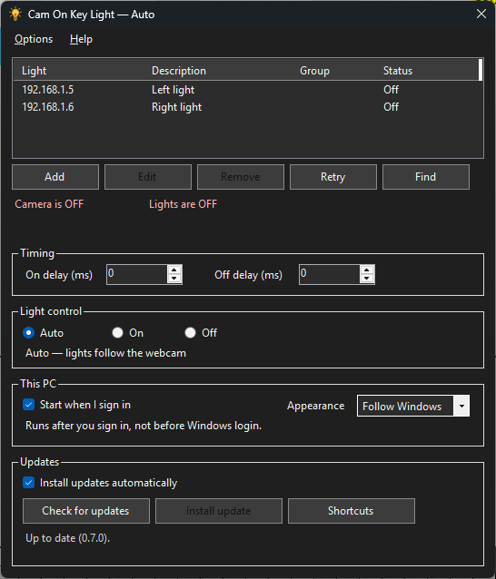
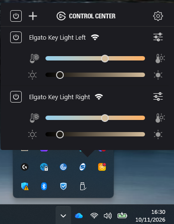

# Cam On Key Light

Automatically turns on and off your Elgato lights when you turn on and off your webcam.

## What are Elgato lights?

[Elgato](https://www.elgato.com/) makes Wi-Fi LED panel lights, such as the Key Light, Key Light Air and Key Light Mini, for people who present, stream or work on camera. You can adjust their brightness and colour temperature from your computer or phone.

## Why use them on calls?

Most rooms light you badly for video. A window behind you leaves your face in shadow, and overhead lights cast harsh shadows. A Key Light set up in front of you gives even, soft light on your face, so you look clear and natural on Teams, Zoom, Google Meet and other calls.

## What Cam On Key Light does

You shouldn't have to remember to switch your lights on before every call and off again afterwards. Cam On Key Light runs in the Windows system tray and watches for any app using your webcam. When a call turns your camera on, it turns your lights on. When the camera goes off, it turns them off again after a short delay. You can still switch them on or off by hand from the tray at any time.

## Get cashback on an Elgato light

Buying an Elgato light? Sign up through my [TopCashback referral link](https://www.topcashback.co.uk/ref/techboy) to get cashback on your purchase.

## How it looks

The main window lists each light's address, description, group and status. **Add**, **Edit**, **Remove**, **Retry** and **Find** sit under that list. The lines below show whether the camera is on and whether the lights are on, and the rest of the window holds the delays, Auto / On / Off, sign-in, appearance and updates. **Options** and **Help** are on the menu bar.



## Features

- In **Auto**, lights follow the webcam. **On** holds every configured light on, and **Off** holds them off.
- Each light shows its own status: On, Off, Unreachable, Unexpected reply or Checking.
- **Find** searches the local network. On startup the app also reads addresses saved by Elgato Control Center.
- Optional descriptions and groups. From the tray, a group can be switched on or off, or set to 25, 50, 75 or 100 percent brightness.
- Quiet hours, and a choice of which camera apps count.
- Optional keyboard shortcuts for Auto, On and Off.
- Light, Dark, or Follow Windows.
- A per-user installer and a portable zip. Updates come from the stable releases of this project.
- Starts when you sign in, if you tick that option.

## Requirements

- 64-bit Windows 10 (version 1607 or later) or Windows 11. The .NET 8 runtime is included in the download, so you do not install it separately.
- This PC and the lights on the same local network. The app talks to each light over HTTP. The port is 9123 unless you put a different port on the address.
- The setup program installs for the current user and does not ask for administrator approval.

The app leaves Windows networking, VPN, routes and company security software as they are.

## Download

The latest stable release is [on GitHub](https://github.com/Techboy/CamOnKeyLight/releases/latest).

- **`CamOnKeyLight-Setup.exe`**: download this one. It is the normal installer.
- **`CamOnKeyLight-win-x64.zip`**: the portable copy. Unzip it and run it. The automatic updater also uses this file.
- **`.sha256` files**: checksums for checking a download. You can ignore them.
- **`AutoKeyLight-win-x64.zip`**: the package version 0.6.0 expects. For a new install, use the setup program or `CamOnKeyLight-win-x64.zip`. See [Updates](#updates).

The build is not code-signed. There is no paid certificate. Windows SmartScreen may say "Windows protected your PC" the first time you open the installer or the program. Choose **More info**, then **Run anyway**.

### Installer

1. Download `CamOnKeyLight-Setup.exe`. `CamOnKeyLight-Setup.exe.sha256` is the checksum for that file.
2. Run the setup. It installs to `%LOCALAPPDATA%\Programs\CamOnKeyLight`, adds a **Cam On Key Light** shortcut to your Start menu, and adds a per-user uninstall entry in Windows Settings.
3. If an older Auto Key Light install is there, setup closes it, removes that install, its Start menu shortcut and its uninstall entry, and keeps your settings.
4. If Cam On Key Light or Auto Key Light is already running, setup asks you to close it before replacing the program files.

Uninstall removes the program, the Start menu shortcut, and a sign-in startup entry that still points at this install. It leaves `%LOCALAPPDATA%\CamOnKeyLight` in place, which is where your settings and update backup live.

On a new install, **Start when I sign in** stays off until you tick it. If an older copy already started at sign-in, that choice is kept.

### Portable zip

1. Download `CamOnKeyLight-win-x64.zip` and, if you want to check it, `CamOnKeyLight-win-x64.zip.sha256`.
2. Extract it to a normal folder you can write to. Run it from that folder, not from inside the zip, and not from `C:\Windows`.
3. The .NET runtime is included.

The automatic updater always downloads that zip, whether you installed with setup or extracted the zip. It replaces the program files in the folder you are running, and it does not switch a portable folder over to the Start menu install. The setup program is not an automatic update.

## Usage

Open **Cam On Key Light** from the Start menu, or run `CamOnKeyLight.exe`. The app stays in the notification area. Its icon is a light bulb, lit while the camera is on.

Closing the window hides it and leaves the app running. Double-click the icon to open the window again. **Exit** on the tray menu quits. If you start the app while it is already running, the second start does nothing.

**Auto**, **On** and **Off** are in the window and on the tray menu. The choice is saved for this Windows user. The window title, the line under those choices, and the tick on the tray menu show which one is selected. The tray icon shows the camera, not the mode.

**Help** contains **About Cam On Key Light** and a link to the Elgato website. **Options** on the menu bar opens the extra settings.

## Lights

The list columns are Light, Description, Group and Status.

- **Add** or **Edit** asks for an address, a description and an optional group. You can also double-click a row, or press Enter or F2. Delete removes the selected light.
- An address is the light's IP, for example `192.168.1.5`. Add `:port` only when the light is not on port 9123.
- **Find** on the window, and **Find lights…** on the tray, searches the local network for Elgato lights (`_elg._tcp.local`). The dialog lists the name, address and port. Lights already in the list are skipped. If none answer, the dialog says so.
- A light added from Find remembers its name and serial. If that address later stops responding, then after about 20 seconds the app looks for the same light and updates the address when the match is unique.
- On startup, and again after Add or Edit, the app reads any addresses stored by Elgato Control Center. If a removed address comes back, see [Troubleshooting](#troubleshooting).
- **Retry** checks every light again. A light that does not answer within 5 seconds is shown as Unreachable. The check only asks the light for its status.
- The status text is **On**, **Off**, **Unreachable**, **Unexpected reply**, **Checking…** or **Not checked**. The summary says **Lights are ON** only when every listed light reported on.

The description is saved with the address, for example "Light on the left". A group name is shown in the list. Once any light has a group, the tray **Groups** menu can turn that group on or off, or set its brightness to 25, 50, 75 or 100 percent. Lights with no group are listed there as Ungrouped.

Automatic on and off follows the camera for every light, unless Options limits that to chosen groups. Lights with no group then follow the camera only while **All groups follow the camera** is ticked.

## Timing

Both boxes are in milliseconds, and both apply only in **Auto**.

**On delay (ms)** is how long the camera has to stay on before the lights turn on. A new install uses 0. The maximum is 10 seconds (10000).

**Off delay (ms)** is the pause after the camera turns off, so switching camera apps does not flicker the lights. A new install uses 1500. If you already saved a value, including 0, that saved value is kept. The maximum is 60 seconds (60000). Set it to 0 for an immediate automatic off. If the camera comes back before the delay ends, the pending off is dropped and the lights stay as they were.

**On** and **Off** apply as soon as you choose them. Manual Off does not wait for the off delay.

## Light control

- **Auto** is the original behaviour and the default. Lights follow the webcam. An existing install stays on Auto.
- **On** turns every configured light on and keeps it on, even when the webcam turns off. The next time the app starts, it restores On.
- **Off** turns every configured light off and keeps it off, even when the webcam turns on. The next time the app starts, it restores Off.
- Choosing **Auto** after On or Off sets the lights from the camera's current state straight away. The delays apply to camera changes after that.
- The camera monitor keeps running while the mode is On or Off, so the window can still show the real camera state. In those modes the lights stay on or off as you set them.

## Keyboard shortcuts

Shortcuts are optional, and none are set by default, so the app leaves keys free for other programs.

Open **Shortcuts** from the window or the tray menu. Choose Set, then press Ctrl, Alt or Shift together with a letter, number or function key (F1 to F24). Esc cancels. Clear removes one. A combination that rarely clashes is Ctrl+Alt+Shift with a letter.

The shortcut works while the window is closed. The tray menu shows it next to Auto, On or Off. Common editing and Windows shortcuts, such as Ctrl+C and Alt+F4, are refused, and the Windows key is refused too. If Windows says another program already owns the shortcut, the app tells you and leaves the previous shortcut in place. Shortcuts are released when you exit from the tray menu.

## Options

**Options** on the menu bar, and **Options…** on the tray, holds the settings that are not on the main window.

### Quiet hours

Quiet hours stay off until you enable them. Set a start, an end and the days of the week. A range such as 22:00 to 07:00 crosses midnight. If the two times are the same, the selected days are quiet all day. Use 24-hour times, such as 22:00 and 07:00.

While quiet hours are active, automatic mode does not turn lights on. Choosing On or Off, in the window or on the tray, still works. The tray tooltip and menu show whether quiet hours are active.

### Camera apps

**All apps** is the default, which is the existing behaviour: any app using the camera counts. **Only these apps** or **All except these apps** uses the apps Windows reports for the camera, shown by exe name, plus names you type yourself. A name is added to the list after that app uses the camera.

### Groups

**All groups follow the camera** is ticked by default. Untick it to choose which groups automatic mode may switch. The tray menu can still control any group by hand.

### Notifications

A notice when a light goes offline or comes back is on by default. The new state has to hold for about 20 seconds before a balloon is shown, and the first check after startup stays quiet. A notice after an update is installed is off until you turn it on.

## Appearance

Choose **Light**, **Dark** or **Follow Windows**. The choice is saved. Follow Windows matches the Windows app theme. While Windows high contrast is on, the app keeps the Windows system colours.

## Settings

Light addresses, descriptions, groups, delays, theme, light mode, shortcuts, quiet hours, camera-app rules, notification choices and the update tick box are stored in `%LOCALAPPDATA%\CamOnKeyLight\user-settings.json`. That file sits outside the program folder, so installing, updating or moving the program leaves it in place. A settings file from an older version still loads. Anything that file does not mention yet uses the default.

The first time this version starts, if that file is missing and `%LOCALAPPDATA%\AutoKeyLight\user-settings.json` exists, the app copies the old file and leaves the original in place. It also picks up an existing `user.config` from the older per-folder settings when that file still has your lights. A saved off delay of 0 stays 0. Descriptions start blank until you edit them.

### Start when I sign in

The tick box follows the current user's Startup apps list (`HKCU\Software\Microsoft\Windows\CurrentVersion\Run`). The app runs after you sign in. It does not run before Windows login, and it does not need administrator approval. The command is stored in quotes under the name `CamOnKeyLight`. An older `AutoKeyLight` or `MyApp` entry that pointed at this app is moved to that name and updated to the copy you are running, so a previous folder is not launched after you move or install the app. If sign-in startup was off, it stays off.

## Updates

This version checks only stable releases of [Techboy/CamOnKeyLight](https://github.com/Techboy/CamOnKeyLight/releases) and downloads `CamOnKeyLight-win-x64.zip`. Pre-releases and drafts are ignored. It does not update from the upstream [astutejoe/AutoKeyLight](https://github.com/astutejoe/AutoKeyLight) project, and it does not send a token or other credential.

**Install updates automatically** is ticked by default. Untick it to stop background checks and unattended installs. While it is ticked, the first check runs shortly after startup, then about every six hours. **Check for updates** still works with the tick box clear, and **Install update** appears only after a package has been downloaded and checked.

An update waits while the webcam is on. Automatic install also waits until the camera has been off for 15 seconds. If GitHub cannot be reached, the app keeps the version you already have and says so.

A download is accepted only from this repository's GitHub release. The zip is checked against GitHub's asset digest, when GitHub provides one, and against the published SHA-256 file. It is then extracted with path checks. The previous program files are copied to `%LOCALAPPDATA%\CamOnKeyLight\updates\backup` before they are replaced, and restored if the copy fails or the new program's version does not match the release. After a successful update the app restarts into the tray.

Version 0.6.0 is different. It asks GitHub for a repository named Techboy/AutoKeyLight, and it only accepts a download address under `/Techboy/AutoKeyLight/releases/download/`. This repository is now Techboy/CamOnKeyLight, and GitHub lists the files under that name, so a PC still on 0.6.0 will not take the update by itself. Install `CamOnKeyLight-Setup.exe`, or the current portable zip, on that PC. The release still includes `AutoKeyLight-win-x64.zip` because that is the package shape 0.6.0 knows how to open: it has to contain `AutoKeyLight.exe` and it must not contain `CamOnKeyLight.exe`.

## Troubleshooting

**An address you removed comes back after a restart.** The app reads lights from `%APPDATA%\Elgato\ControlCenter\Settings.xml` when Elgato Control Center has saved them. Open that file and delete the old `<IpAddress>` entries inside `<Accessories>`, or delete the file. Deleting the file clears the settings Control Center stored there.

**A light is missing from the list.** Press **Find**, or type the IP yourself. Elgato Control Center, opened from the system tray, lists the lights on this PC. Open a light there to see its IP address.



If you can reserve an address for the light on your router, it keeps the same IP after the light restarts.

**The status says Unreachable.** The light did not answer within 5 seconds. Check that this PC and the light are on the same network, then press **Retry**. Retry only checks the connection. It leaves VPN settings, routes and security software alone.

**The lights flicker when one camera app takes over from another.** Raise **Off delay**. A new install uses 1500 ms, which is there for that gap.

**The lights stay off during a call.** Confirm the mode is **Auto**, quiet hours are not active, and **Camera apps** is not set to ignore the program you are in. The camera line follows Windows: it is on when an app is streaming from the camera.

**The lights stay on after a call.** **On** keeps them on. In **Auto** they wait out the off delay, and they stay on if Windows still reports the camera as in use.

**Nothing happens when you open the app.** It is already running, or you closed the window earlier. Look for the light-bulb icon in the notification area. **Exit** on that menu is what quits.

## Releasing a new version

The repository is [Techboy/CamOnKeyLight](https://github.com/Techboy/CamOnKeyLight). Publishing a release uses the free `windows-latest` runner. That workflow does not use a code-signing certificate, an Actions cache, or a stored Actions artifact.

1. Pick the next version, for example `0.8.0`.
2. Create a GitHub release and tag it `v0.8.0`. Leave it as a normal release, not a pre-release and not a draft. The tag has to look like `v1.2.3`.
3. Publish the release. The workflow attaches `CamOnKeyLight-win-x64.zip`, `CamOnKeyLight-win-x64.zip.sha256`, `AutoKeyLight-win-x64.zip`, `AutoKeyLight-win-x64.zip.sha256`, `CamOnKeyLight-Setup.exe` and `CamOnKeyLight-Setup.exe.sha256`.
4. Wait until those files are listed. People installing for the first time run the setup program. Copies already on 0.7.0 or later download `CamOnKeyLight-win-x64.zip`.

The version in the program comes from that tag. The workflow builds the zip files and the setup program from the same folder. Attach those files by hand only if the workflow failed. The app expects the checksum and GitHub's digest to describe the same zip.

`AutoKeyLight-win-x64.zip` is still produced so the legacy package keeps the file name version 0.6.0 will accept. A PC on 0.6.0 will not download it on its own after the repository rename. See [Updates](#updates).

## Build

The logic tests run on .NET 8, including on a machine that is not running Windows:

```bash
dotnet test CamOnKeyLight.Core.Tests/CamOnKeyLight.Core.Tests.csproj -c Release
```

The Windows app itself builds on Windows:

```powershell
dotnet publish CamOnKeyLight/CamOnKeyLight.csproj -c Release -r win-x64 --self-contained true
```

To build the packages a release would publish, on Windows, pass the version to stamp into the build:

```powershell
pwsh -NoProfile -File build/package.ps1 -Version 0.8.0
```

The script publishes the app, runs the package checks, and writes `CamOnKeyLight-win-x64.zip`, `AutoKeyLight-win-x64.zip` and `CamOnKeyLight-Setup.exe` under `dist`, with a `.sha256` file beside each one. The setup program is compiled with Inno Setup 6.4.3. If that compiler is not already unpacked in the build's work folder, the script downloads it.

## Licence

Cam On Key Light is based on [astutejoe/AutoKeyLight](https://github.com/astutejoe/AutoKeyLight). It is MIT licensed. Copyright (c) 2022 Gabriel Garcia. See [LICENSE](LICENSE).

Cam On Key Light is an independent app. It is not made, sold or endorsed by Elgato.
